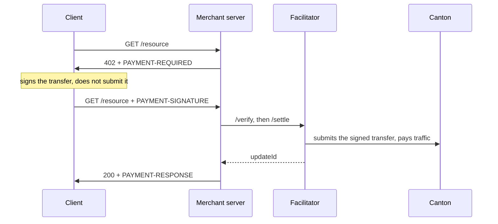

A server answers `402` with payment requirements. The client signs a Canton transfer to the merchant and retries the request with it. The merchant's server passes it to the facilitator, which checks it, submits it and pays the network fee. The merchant's `TransferPreapproval` makes the transfer settle in one transaction. The facilitator never holds the funds.



FTP wallets need no Canton node: the facilitator also acts as their relay and prepares each transaction. The wallet checks the prepared transaction and its hash before signing; the relay never signs.

The normative rules are in the x402 spec, [`scheme_exact_canton.md`](https://github.com/x402-foundation/x402/blob/main/specs/schemes/exact/scheme_exact_canton.md). It covers Canton Coin; FTP's facilitator also settles the tokens listed below.

## Payment requirements

```json
{
  "scheme": "exact",
  "network": "canton:mainnet",
  "amount": "10000000000",
  "asset": "CC",
  "payTo": "<merchant party>",
  "maxTimeoutSeconds": 120,
  "extra": {
    "assetTransferMethod": "transfer-factory",
    "feePayer": "ftp-x402-infrastructure::1220da867ceb28e1531ebfbea9ca9b25f75be06755999f48f0ec4b96f4174e3cd133",
    "synchronizerId": "global-domain::1220b1431ef217342db44d516bb9befde802be7d8899637d290895fa58880f19accc",
    "instrumentId": { "admin": "DSO::1220b1431ef217342db44d516bb9befde802be7d8899637d290895fa58880f19accc", "id": "Amulet" },
    "executeBeforeSeconds": 120
  }
}
```

- `amount`: atomic units, 10 decimals for every token. `"10000000000"` is 1 CC.
- `payTo`: the merchant's party id.
- `extra.instrumentId`: the token. A token's `asset` is `"<admin>::<id>"`.
- `extra.memo` (optional): a reconciliation tag. The payment must carry the same value.

Headers are x402 v2: `PAYMENT-REQUIRED`, `PAYMENT-SIGNATURE`, `PAYMENT-RESPONSE`.

## MainNet values

From `GET https://facilitator.ftptech.xyz/supported` on 2026-10-24.

| Value | MainNet |
|---|---|
| `feePayer` | `ftp-x402-infrastructure::1220da867ceb28e1531ebfbea9ca9b25f75be06755999f48f0ec4b96f4174e3cd133` |
| `synchronizerId` | `global-domain::1220b1431ef217342db44d516bb9befde802be7d8899637d290895fa58880f19accc` |

| Token | `instrumentId.admin` | `instrumentId.id` |
|---|---|---|
| CC | `DSO::1220b1431ef217342db44d516bb9befde802be7d8899637d290895fa58880f19accc` | `Amulet` |
| USDCx | `decentralized-usdc-interchain-rep::12208115f1e168dd7e792320be9c4ca720c751a02a3053c7606e1c1cd3dad9bf60ef` | `USDCx` |
| CBTC | `cbtc-network::12205af3b949a04776fc48cdcc05a060f6bda2e470632935f375d1049a8546a3b262` | `CBTC` |
| USDXLR | `excellar-issuer::12203d1e36930ee0e3fbb898add7e222a47ae9d2a5f0f6187e3a446ea32f871ce2ca` | `USDXLR` |
| cETH | `rails-cethMain-1::12200350ba6e96e3b701c3048b5aa013a8c1c08833e8ebf54339cff581055c29003a` | `cETH` |
| eXAG | `ember-silver::1220ad9c097ae75192b4716854fa413aa8582c86a62b16714663cdab55e025cc79c4` | `eXAG` |
| eXAU | `ember-gold::1220ad9c097ae75192b4716854fa413aa8582c86a62b16714663cdab55e025cc79c4` | `eXAU` |

The previous facilitator party, `FTP-validator-1::1220c065ad977ae4e480b6ea5bcd96d6d73025a91ad27fa60d1385010ca01cdd39f9`, is still accepted as `feePayer` for a while. Switch to the current one.

## Errors

| Code | What to do |
|---|---|
| `invalid_exact_canton_preapproval_missing` | The merchant has no live preapproval. The merchant runs `canton-agent-wallet preapproval`. |
| `invalid_exact_canton_fee_payer_mismatch` | The merchant updates `feePayer` to the value above. |
| `invalid_exact_canton_amount_mismatch`, `_merchant_mismatch`, `_instrument_id_mismatch`, `_memo_mismatch` | The payment does not match the 402. Pay what the 402 asks. |
| `invalid_exact_canton_expired`, `_execute_before_too_far` | Pay again with a fresh deadline. |
| `invalid_exact_canton_insufficient_balance`, `_insufficient_inputs` | Nothing moved. Fund the wallet. |
| `invalid_exact_canton_input_contention` | Nothing moved. Safe to pay again. |
| `invalid_exact_canton_execute_failed` | The outcome may be unknown. Do not pay again before checking the balance. |
| `invalid_exact_canton_missing_proof`, `_malformed_payload`, `_signature_invalid` | Client bug or outdated client. Upgrade it. |
| `unexpected_canton_ledger_error` | Check `network` and `assetTransferMethod`. |

An HTTP `503` from `/settle`, or a `502` from the merchant, also means the outcome is unknown: check before paying again.

Replays are refused on-ledger: a signed transfer spends specific holdings, so it can settle only once.
